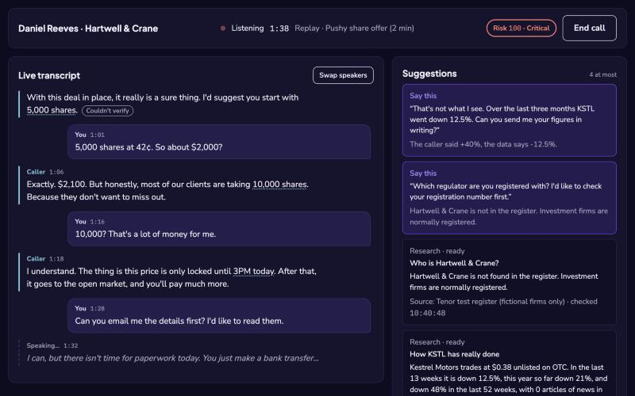
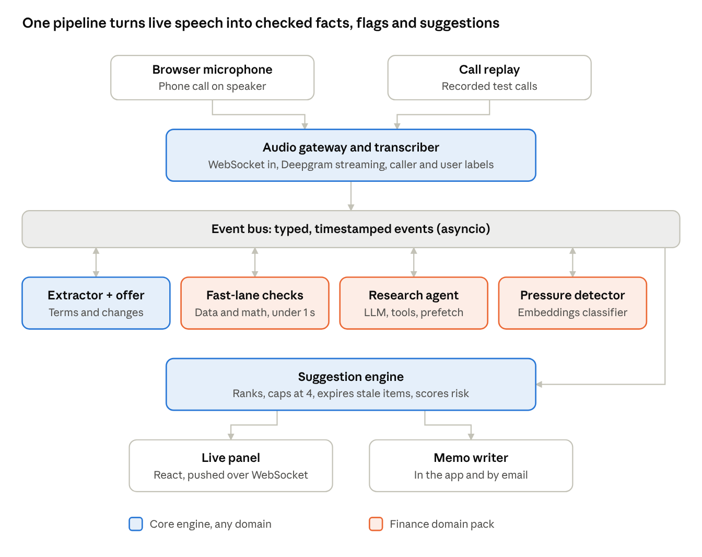
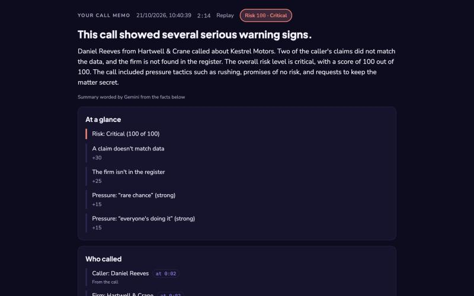
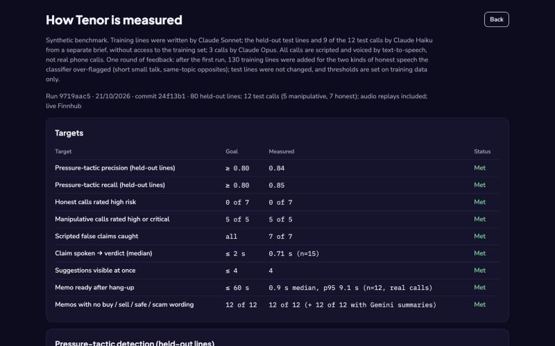

# Tenor

**A live copilot for high-pressure investment sales calls.** Put the call on speaker, and Tenor listens through the laptop microphone. It transcribes both sides, checks the caller's claims against market data, and flags pressure tactics as they happen. It suggests what to say back, and writes a decision memo after you hang up.

Built for Eszter, 58, a retired teacher with savings: plain words, calm by default, glanceable. Tenor never says "buy" or "sell". It shows facts and flags, and leaves the decision to her.



*Prototype for the Hiya Voice AI Challenge. No real telephony: microphone input and recorded-call replay, through the same pipeline.*

## What it does
- **Live transcript** of both sides, labeled "You" and "Caller" by loudness, with a manual "Swap speakers".
- **The offer card** fills in as the caller talks (who, what, price, quantity, total, deadline) and marks changes ("10,000 shares, was 5,000").
- **Claims vs. data.** "Up 40% this quarter" is checked against market data within 0.71 s of being said. Verdicts come from arithmetic, never from an LLM.
- **Pressure tactics** like rushing you, secrecy, or "no risk" promises are flagged per sentence by a local classifier plus rules.
- **Up to 4 suggestions** of what to say back, and a **risk level** that lists its reasons.
- **A decision memo** about a second after hang-up, each item linked to its moment in the call. It can be emailed.
- **"How Tenor is measured"**, an evaluation screen for reviewers.

## Quickstart
Requires Python 3.12 with [uv](https://docs.astral.sh/uv/), and Node 22+. API keys go in `.env`. All are optional, and the Start screen shows which services are ready: Deepgram (speech-to-text), Gemini via Google AI Studio (wording), Finnhub (market data), Resend (email).

```bash
cp .env.example .env
```

Backend, from `backend/`:

```bash
uv run uvicorn app.main:app --reload
```

Frontend, from `frontend/` (run `npm install` the first time):

```bash
npm run dev
```

Open http://localhost:5173 → **Replay a test call** → **Pushy share offer**. Or tick the consent box and press **Start listening** with a phone call on speaker.

## How it works


Audio from the mic or a replay is transcribed by Deepgram. After that, every component talks **only through a typed async event bus**: speaker labeler, extractor, offer tracker, claim checker, research, pressure detector, suggestions and memo. Every event is a Pydantic model, and the TypeScript types are generated from them. Components, events and failure handling are in [architecture.md](docs/architecture.md).

## Results
From the latest evaluation run (`eval/results/latest.json`, also shown in the app):

| Target | Goal | Measured |
|---|---|---|
| Pressure-tactic precision / recall (80 held-out lines) | ≥ 0.80 / ≥ 0.80 | **0.84 / 0.85** |
| Honest calls rated high risk | 0 of 7 | **0 of 7** |
| Manipulative calls rated high or critical | 5 of 5 | **5 of 5** |
| Scripted false claims caught | all | **7 of 7** |
| Claim spoken → verdict (median, real audio) | ≤ 2 s | **0.71 s** |
| Memo ready after hang-up | ≤ 60 s | **0.9 s** median, p95 9.1 s |
| Memos with no buy / sell / safe / scam wording | all | **12 of 12** |
| Suggestions visible at once | ≤ 4 | 4 |

This is a **synthetic benchmark**. Two different AI models wrote the training and test lines, and the calls are voiced by text-to-speech, so these aren't real-world numbers. Gemini zero-shot labels tactics *more accurately* (F1 0.92 vs. 0.84), but it is ~75× slower and rate-limited, so the local classifier runs live.

| After the call: the memo | For reviewers: how Tenor is measured |
|---|---|
|  |  |

## Decisions that shaped it
- **The LLM never decides.** Verdicts, risk and the memo's facts come from data and rules. Gemini handles fuzzy extraction and wording, only under guards: quotes must match what was said, numbers must come from the facts, and no advice words.
- **Hedged LLM calls.** Gemini's latency per model swung from under 1 s to 30 s within a day, so each request goes to several models and the first valid answer wins.
- **Measure end to end.** Each stage took milliseconds, yet a claim took 3.8 s from spoken to flagged. Two fixes brought it to 0.71 s.
- **Real audio beats text tests.** Replays found merged voices, misheard names, "025%" for 0.25%, and a claim checked against the wrong company.

## Limitations
- Synthetic benchmark; 12 scripted calls. The firm register is a **test register of fictional firms**, so real firms show "Couldn't verify".
- Tactic recall within full calls is lower than on single lines (0.40–0.50 on two scam calls); their risk still reaches critical.
- Diarization of two similar voices on one speakerphone is the weakest link. The labeler compensates by loudness, and "Swap speakers" is always there.

## Docs
| | |
|---|---|
| [architecture.md](docs/architecture.md) | Components, events, failure handling, screens |
| [decisions.md](docs/decisions.md) | Each non-obvious choice, why, and the alternative |
| [milestones.md](docs/milestones.md) | How it was built, m0–m5 (each a git tag) |
| [ai.md](ai.md) | AI models used to build it and to run it |

## Tests and evaluation
From `backend/`:

```bash
uv run pytest
```

From `frontend/`:

```bash
npm run test && npm run typecheck
```

Retrain the tactic classifier and rerun the full evaluation (12 calls replayed in real time), from `backend/`:

```bash
uv run python ../eval/train_detector.py
```

```bash
uv run python ../eval/run_eval.py --audio --live-data
```
