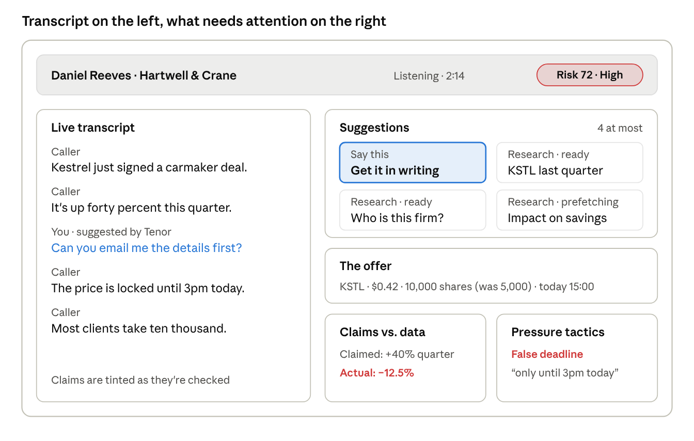

# Tenor: architecture and build plan

> **Imported into the repo on 2026-10-20** from *Tenor architecture and build plan.docx* (Oct 19, 2026). The text below is the original. Changes made since then (reasons in [`decisions.md`](decisions.md)):
> - **LLM:** Google Gemini via a Google AI Studio key, not Claude (`gemini-3.5-flash-lite` for extraction, `gemini-3.8-flash` for research and the memo; see [`../ai.md`](../ai.md)).
> - **Visual language:** a dark theme inspired by Hiya's brand (deep indigo, one violet accent, purple→cyan gradient for brand moments only). The rules below still apply: one accent, severity always with a text label, motion only for news. Tokens: `.claude/skills/tenor-ui/SKILL.md`.
> - **M1 pulled forward** the event bus and a minimal replay source (both listed under M2), so components use the bus from day 1 and every milestone demo works on replay.
> - **Speaker labels:** the labeler (not the transcriber) publishes `utterance.partial/final`, because the labels belong to it. `speakers.updated` carries a *list* of user speakers, because diarization can split one voice into two speaker numbers. It can also merge two similar voices into one; the labeler then splits that speaker by loudness into a second voice numbered 100 + n, so `speaker_index` is a voice number.

Oct 19, 2026

Tenor will be a polished end-to-end web prototype that listens through the laptop microphone, with the call on speaker. It runs one real pipeline from speech to a live analysis panel and a post-call memo, and is built in five milestones, each ending in something demoable.

## Scope after the consultation

The team confirmed three things on 19 October:

- **No real phone integration.** Microphone input with the phone on speaker is enough. Telephony (Twilio, softphones) stays a documented future source behind the same interface.

- **End to end and polished beats broad.** Every stage must work for real on a live or replayed call, with a UI that looks finished.

- **Show the thinking.** The architecture, the milestones and the decisions behind them are part of the submission.

Design principles that follow from this:

1.  **One pipeline, swappable inputs.** Live mic and recorded replay feed the same code path, so the demo never depends on luck.

2.  **Calm by default.** The panel stays quiet until something matters, shows at most four suggestions, and escalates by severity.

3.  **Facts are computed, not generated.** Verdicts like "claimed +40%, actual −12.5%" come from data and arithmetic; the LLM extracts and explains but never decides a number.

4.  **Every result shows its source.** Missing data reads "couldn't verify", never a guess.

5.  **Measured, not claimed.** Latency and detection quality are logged and reported.

## System overview

System overview · 2 inputs, 1 event bus, 2 outputs

The browser streams mic audio to the backend; replay feeds a recorded call into the same gateway. Every stage after transcription talks only through the event bus, and only the suggestion engine decides what reaches the panel.

## Components

Nine components, each a separate Python module with one job, so each can be tested and timed on its own.

| Component | Responsibility | Technology | Latency target |
|----|----|----|----|
| Audio source | Capture mic audio in the browser, or replay a recorded call file, as 16 kHz PCM chunks | Web Audio API (browser), file reader (replay) | 20–100 ms chunks |
| Transcriber | Stream audio to STT; emit interim and final words with speaker labels | Deepgram streaming with diarization | ~300 ms to first words |
| Speaker labeler | Map diarized speakers to *caller* and *user* (the user is louder and closer to the mic) | Loudness heuristic + first-turn rule | \<10 ms |
| Entity extractor | Find tickers, prices, percentages, quantities, dates, firm names | Regex + ticker list, then a small LLM for fuzzy cases | 50–500 ms |
| Offer tracker | Keep the current offer as structured state; detect changed terms | Python state machine | \<10 ms |
| Claim checker (fast lane) | Verify factual claims against data with plain arithmetic | Market data, register and fund adapters | \<1 s |
| Research agent (slow lane) | Answer open questions (news, filings, context) with sources; prefetch on mention | LLM with tool use, async | 3–15 s, off the critical path |
| Pressure detector | Score each caller utterance against the tactic taxonomy over a rolling window | Sentence embeddings + logistic regression, rules as backup | \<300 ms |
| Suggestion engine | Merge all signals, rank, cap at 4, expire stale items; compute call risk | Python, scored rules | \<10 ms |

Two outputs sit on top: the **live panel** (React, updated over a WebSocket) and the **memo writer**, which turns the final call state into the decision memo shown in the app and sent by email.

## Data model and events

Components never call each other directly. Each one publishes typed events to an in-process async event bus and subscribes to the ones it needs, so stages run concurrently and a slow research call can't hold up a fast check.

| Event | Published by | Consumed by |
|----|----|----|
| utterance.partial / utterance.final | Transcriber | Extractor, pressure detector, panel |
| entity.detected | Entity extractor | Offer tracker, claim checker, research agent (prefetch) |
| claim.extracted | Entity extractor | Claim checker |
| offer.updated / offer.changed | Offer tracker | Suggestion engine, panel |
| claim.checked | Claim checker | Suggestion engine, panel |
| research.ready | Research agent | Suggestion engine |
| tactic.flagged | Pressure detector | Suggestion engine, panel |
| suggestions.updated / risk.updated | Suggestion engine | Panel |
| call.ended | Session | Memo writer |

The core objects, as Pydantic models shared by backend and the TypeScript UI (generated types):

Utterance(id, speaker: "caller" \| "user", text, t_start, t_end, is_final)  
Entity(id, kind: "ticker" \| "price" \| "percent" \| "quantity" \| "deadline" \| "firm", value, utterance_id)  
Claim(id, text, metric, claimed_value, period, status: "checking" \| "verified" \| "false" \| "not_found" \| "unverifiable", actual_value, source, checked_in_ms)  
Offer(instrument, market, price, quantity, total, fees, deadline, payment, history: list\[TermChange\])  
TacticFlag(tactic, quote, severity: "mild" \| "strong", utterance_id, score)  
Suggestion(id, kind: "research" \| "say_this", title, priority, status: "prefetching" \| "ready", result, source, expires_at)  
CallSession(id, started_at, utterances, offer, claims, flags, suggestions, risk_history)

Every event carries a timestamp, so the full call can be replayed and every latency measured from the log.

## Key decisions

Each decision favors a reliable, explainable demo in five days over breadth.

| Decision | Choice | Why | Alternative considered |
|----|----|----|----|
| Audio input | Browser mic via Web Audio, streamed to the backend over WebSocket | Works on any laptop, no drivers, one app to run | Python sounddevice capture; Twilio (out of scope) |
| Speech to text | Deepgram streaming with interim results and diarization | Low latency, speaker labels in the stream | AssemblyAI streaming; local Whisper (slower on a laptop) |
| Backend | Python 3.12, FastAPI, asyncio event bus | Native async, WebSockets built in, fits the ML parts | Node.js (weaker for the classifier work) |
| Extraction | Rules first, small fast LLM only for fuzzy claims | Milliseconds for most entities; LLM cost and delay only where needed | LLM for everything (slower, less predictable) |
| Verdicts | Arithmetic on data, never LLM judgment | Explainable, repeatable, no invented numbers | LLM "is this claim true?" (can hallucinate) |
| Market data | Adapter interface with two implementations: a live API (Finnhub) and a local fixture for fictional companies | Real data for real tickers; fictional scam firms avoid naming real companies | Live data only (no safe way to demo a scam stock) |
| Pressure detector | Embeddings + logistic regression trained on a labeled set, compared against an LLM zero-shot baseline | Fast, measurable, and the comparison is part of the story | LLM only (no evaluation to show) |
| Frontend | React + TypeScript + Vite, Zustand for state, Framer Motion for restrained transitions | Fast iteration, typed events end to end | Plain HTML (hard to keep polished as state grows) |
| Storage | In-memory session; SQLite for saved calls and evaluation runs | Nothing to deploy; calls replayable later | Postgres (unnecessary for a prototype) |
| Email | Resend, with the same memo also rendered in the app | One API call; the demo doesn't depend on an inbox | SMTP |

## UI design

The interface is built for a person who is listening, not reading: one glance should say whether something is wrong, and one more should say what to do about it.

Live panel wireframe · desktop, mid-call

The call strip carries the one number that matters (risk) at all times. Below it, the transcript gives context, and the right rail is ordered by urgency: what to do now, then what's on the table, then the evidence.

| Screen | Purpose | What it shows |
|----|----|----|
| Start | Consent and mic check before listening | Consent confirmation, input level meter, "Start listening" or "Replay a test call" |
| Live | The working view during a call | Call strip with risk, transcript, suggestions, offer card, claims, pressure tactics |
| Alert | A strong flag or a failed claim | The risk pill turns critical, the related "say this" suggestion moves to first place; no pop-ups or sounds |
| Memo | After hang-up | The decision memo in the app, a send-by-email action, links back to each moment in the transcript |
| Evaluation | For reviewers, not end users | Latency per stage and detector metrics from the test set |

Visual language:

- **Quiet neutrals, one accent.** The accent marks Tenor's own suggestions; red, amber and green are reserved for severity and always come with a text label, never color alone.

- **Readable at arm's length.** "Say this" lines use the largest body type on screen, because the user reads them aloud mid-call.

- **Motion only for news.** New items fade in once; nothing pulses or bounces while the user is trying to listen.

- **Plain words.** "Doesn't match data", not "claim falsified"; every result shows where it came from.

## Milestones

Build plan · 5 milestones, 1 per day

The pipeline is built front to back, so from day 1 there is always something running end to end, and later days deepen it rather than add parallel pieces. Each milestone gets a short screen recording and a commit tag (m1…m5), which become the "thinking process" section of the submission. Day numbers assume five working days from the start of the build.

## Evaluation

Tenor is judged on a small scripted test set run through the real pipeline, with results reported in the submission.

- **Test set:** about 12 recorded calls (6 manipulative, 6 honest, including hard honest cases such as a real deadline on a bank promotion), plus roughly 300 labeled caller utterances for the tactic classifier, split 80/20.

- **Sources for tactic examples:** scripted lines, plus phrasing from public regulator warnings and fraud case write-ups.

- **Honesty about data:** results are a prototype benchmark on synthetic calls, not real-world accuracy.

| Metric | Target |
|----|----|
| Claim spoken → verdict on screen (median) | ≤ 2 s |
| False claims caught on test calls | All scripted false claims |
| Pressure-tactic precision / recall (held-out utterances) | ≥ 0.8 / ≥ 0.8 |
| False "high risk" on honest calls | 0 of 6 |
| Memo ready after hang-up | ≤ 60 s |
| Suggestions visible at once | ≤ 4 |

## Risks and fallbacks

| Risk | Effect | Fallback |
|----|----|----|
| Speakerphone audio is noisy or echoes | Misheard words, wrong speaker labels | Quiet room, external mic; replay mode for the recorded demo |
| Diarization mixes up speakers | Claims credited to the user | Loudness heuristic; manual "swap speakers" control |
| Misheard ticker ("K S T L") | Wrong research | Match against known tickers plus company name; show uncertainty on the offer card |
| STT or LLM API slow or down | Gaps in the panel | Timeouts per check, "couldn't verify" state, cached fixtures for the demo |
| Classifier underperforms on small data | Missed or false flags | Rules as a backup layer; report both numbers honestly |
| Scope creep on day 4–5 | Unpolished UI | Cut order: email sending → slow-lane agent → extra scenarios; never cut the core loop |
