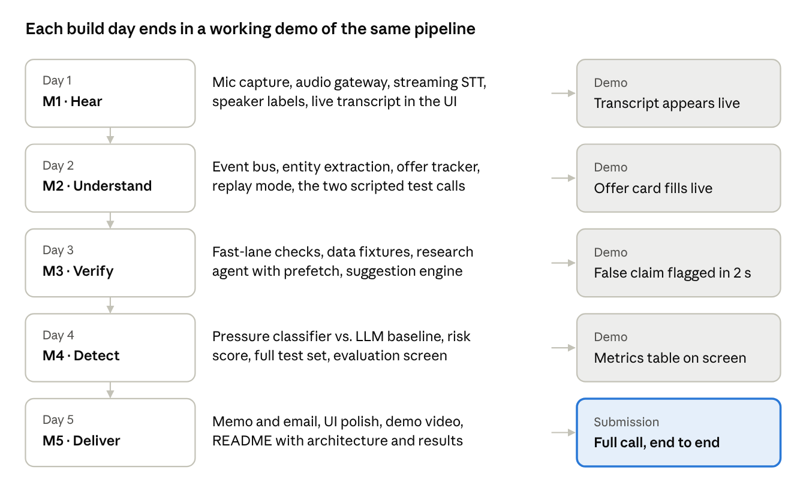

# Milestones

Tenor was built front to back, so something ran end to end from the first day. Each milestone is a git tag (`m0`–`m5`) whose demo works on a replayed call.

| Tag | Milestone | What it added | Measured |
|---|---|---|---|
| `m0` | Skeleton | FastAPI + React apps, typed health socket, TypeScript types generated from the Pydantic events, latency log | Health round trip 1–27 ms |
| `m1` | Hear | Browser mic (AudioWorklet, 16 kHz), replay source, event bus, Deepgram streaming with diarization, speaker labeler, live transcript | Words on screen in 0.3 s (median) |
| `m2` | Understand | Spoken-number normalizer, rules-first extraction (Gemini only for fuzzy lines), offer tracker with changes, scripted test calls | Final offer matches the expected one exactly; rules take ~1 ms |
| `m3` | Verify | Market data (Finnhub + fixtures), claim checks by arithmetic, research prefetch, suggestions (≤ 4), risk score | Claim spoken → verdict in 0.79 s (was 3.8 s) |
| `m4` | Detect | 8 pressure tactics, rules + MiniLM classifier, Gemini zero-shot baseline, 12 test calls, evaluation screen | Precision 0.84 / recall 0.85; 0 of 7 honest calls rated high |
| `m5` | Deliver | Decision memo built from facts, SQLite, email via Resend, UI polish, README | Memo ready 0.9 s after hang-up; all 9 targets met |

## What real runs caught
Each milestone was checked on real audio, not only in tests. That's where most of the bugs were.

- **m1:** Deepgram split one voice into two speaker numbers, so labels are now per speaker, by loudness. A "fast" replay dropped most of the call, so files now play in real time.
- **m2:** "Is this Eszter?" was heard as a name, "a quarter percent" came back as "025%", and two similar voices were merged into one speaker. The labeler now splits a merged speaker by loudness.
- **m3:** Every stage took milliseconds, yet the key claim took 3.8 s from spoken to flagged. Two fixes brought it to 0.79 s: extracting per sentence, and asking Deepgram to finalize after a pause.
- **m4:** Thresholds tuned on one AI author's lines gave precision 0.60 on the other author's. I made one disclosed round of fixes, using training data only. A read-aloud test call then found four bugs that synthetic calls hadn't, one of them a claim checked against the wrong company.
- **m5:** The memo model's 400 error was my own thinking-level setting, not an outage. The word guard caught Gemini calling the test register "official".
- **After m5:** Live speakerphone calls merged both people into one speaker, and neither loudness nor bass told them apart in a real room. Live calls now start with a short voice check, and every stretch is matched against that voice.

Why each fix took the shape it did is in [decisions.md](decisions.md); the final numbers are in the [README](../README.md#results).
